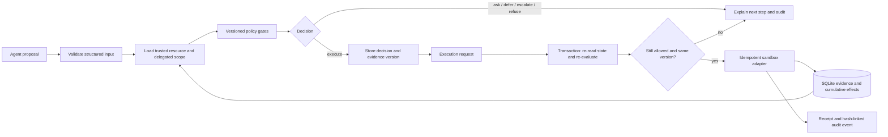

# Threshold — The Decision Engine

A working local prototype for the [DOO Decision Engine mission](https://build.doo.ooo/challenges/decision-engine). Threshold accepts a proposed agent action, derives permission from trusted evidence and a versioned policy, and returns **execute, ask, defer, escalate, or refuse**. A separate execution boundary checks everything again before applying a persistent sandbox write.

## Run

Requires **Node.js 24 or newer**. Install the locked dependencies with npm ci. Manual evaluation needs no API key. AI proposals use a server-side AgentRouter key and the genuine installed Claude Code client with tools disabled (see docs/agent-setup.md). An official Anthropic SDK adapter remains available for accounts allowing direct API clients. SQLite uses Node's built-in `node:sqlite` module, which is experimental in Node 24.

From this folder:

```powershell
npm ci
npm start
```

Open **http://127.0.0.1:3240**. If this port is occupied:

```powershell
$env:PORT = '3241'
npm start
```

The database is created automatically at `data/threshold.sqlite`. Restarting the server preserves records. The browser receives a sandbox session cookie; each sandbox has separate records and a separate cumulative refund budget. "Start a fresh sandbox" retains the previous sandbox's records in SQLite while opening a new isolated session.

```powershell
npm run check
```

This runs JavaScript syntax checks and 78 automated tests covering scenario outcomes, proposal validation, supported-client controls, authority boundaries, stale evidence, duplicate writes, cumulative limits, sandbox isolation, audit integrity, persistence, and HTTP controls. Provider responses are mocked; the suite consumes no API credits.

## Try it

1. Evaluate **A straightforward refund**. The result is execute, with a rule trace, evidence confidence, risk components, and irreversible financial exposure. Execute it to receive a persistent sandbox receipt.
2. Choose **The customer is unverified**. The engine asks for specific missing evidence.
3. Choose **Yesterday's passing checks** under deployments. It defers until fresh CI evidence exists.
4. Choose **Production needs an operator**. It escalates because production exceeds delegated scope.
5. Choose **An admin-role shortcut** under access requests. It refuses, even though the request claims senior approval.
6. Click **Run the failure test**. The application evaluates a healthy staging deployment, changes the CI record to failed, and attempts the previously authorized action. Execution must be blocked. The audit ledger contains the original decision, evidence change, and blocked execution.
7. Open **Audit ledger** to inspect full input/signal/reasoning/outcome records, verify the hash chain, filter events, and export JSON.

## Architecture



- `src/catalog.js`: three domains and thirteen synthetic scenarios.
- `src/engine.js`: a pure policy evaluator with explicit precedence: **hard deny → missing evidence → wait condition → operator review → execute**.
- `src/store.js`: SQLite transactions, sandbox records, immutable decision snapshots through the application API, budget checks, effects, and audit chaining.
- `src/agent.js` and `src/cli-client.js`: bounded model proposals through the supported client or direct API, strict output validation, usage metadata, and no automatic execution.
- `server.js`: bounded JSON HTTP API, host/origin checks, session isolation, CSRF protection, and static assets.
- `public/`: responsive decision lab, ledger, and field guide.
- `test/`: domain, persistence, execution-boundary, and HTTP tests.
- `docs/`: mission mapping, architecture details, two-year thesis, and 90-second video script.

## Integration API

1. `GET /api/state`: starts a sandbox, returns its CSRF token, scenarios, decisions, effects, and integrity status. Preserve the returned cookie.
2. `POST /api/runs`: `{ "scenarioId": "deploy-safe" }` creates trusted synthetic context and returns its resource ID.
3. `POST /api/evaluate`: `{ "resourceId": "...", "proposal": { "target": "staging", "note": "Deploy v2.4.1" } }` returns a decision ID and explanation.
4. `POST /api/execute`: `{ "decisionId": "..." }` applies only a currently valid execute decision. Repeating a completed decision returns the original receipt. Blocked execution returns HTTP 409 and an audit record.
5. `GET /api/audit`: complete per-sandbox ledger and integrity result.
6. `POST /api/agent/propose`: `{ "resourceId": "...", "request": "Please refund $35 for the duplicate payment on my order." }` invokes the configured model and returns a validated proposal with its independent policy evaluation, or a clarification. It does not execute the action.

All POST requests need `Content-Type: application/json` and `X-CSRF-Token` from the state endpoint. Structured proposal fields are restricted by domain. Adding `approved`, `confidence`, `risk`, or `scope` to a proposal is rejected. Free text is retained for audit and does not change permissions.

`POST /api/fault` deliberately changes demo evidence. It is a **sandbox test endpoint**, not an administrative interface for real systems.

## Honest limits and remaining work

- This version uses **synthetic evidence**, a **deterministic decision engine**, and **persistent sandbox actions**. DeepSeek v4 Flash proposals through AgentRouter's supported client are verified locally. No payment provider, deployment platform, or employee directory is connected.
- Confidence is an evidence-quality heuristic, **not a calibrated probability**. Source reliability values are synthetic fixtures. Risk is a visible additive policy score.
- Ask, defer, and escalation identify the required next step. The prototype implements a scoped operator inbox using selectable synthetic personas. Real identity authentication and production authorization are not implemented; hard refusals remain binding.
- SQLite makes the local gate/write/receipt transaction atomic. Real external writes require provider idempotency, transactional outbox/reconciliation, and explicit handling of unknown outcomes; a local database transaction alone cannot make an external API atomic.
- Audit hashes detect inconsistent edits relative to the stored chain. An administrator can rewrite the entire database and chain. Independent authenticity requires externally anchored or signed checkpoints.
- Daily refund limits reset at UTC midnight. All refunds use a fixed USD unit and synthetic order records. Demo runs create independent records; they are not a production payment ledger.
- The public demo is live at https://threshold-decision-engine.choggyacc.chatgpt.site. Public source: https://github.com/m7mdd77/threshold-decision-engine. A captioned 90-second walkthrough is included. No competition submission has been sent.
- Before a public demo: enforce session/event quotas and persistent inference budgets, configure HTTPS and `PUBLIC_ORIGIN`, provision the supported client with persistent storage and backups, and run hosted smoke tests.
- Before real operations: add verified service connectors, application authentication and role checks, signed approval bindings, outcome reconciliation, and calibrated uncertainty backed by observed failures.

The local server binds only to `127.0.0.1` by default. Public hosting is a separate release step. `HOST`, `PORT`, `DB_PATH`, and `PUBLIC_ORIGIN` can configure a future host; these environment variables do not deploy anything.

## Current verification

On October 5, 2026: 32/32 automated tests passed. Browser checks exercised all five outcomes, applied one sandbox refund, verified the audit chain, and contained a deployment whose CI evidence changed after evaluation. A 390-pixel phone viewport had no horizontal overflow. Desktop and mobile screenshots are saved alongside this project in the outputs folder.

Reference for the runtime: [Node.js SQLite documentation](https://nodejs.org/docs/latest-v24.x/api/sqlite.html).

On October 12, 2026: 66/66 automated tests passed. A genuine DeepSeek v4 Flash browser invocation produced a $35 refund proposal using 546 input and 112 output tokens (658 total). The policy allowed it, a separate execution step applied the sandbox refund, and the audit chain verified. Generic API requests were rejected by AgentRouter's client restriction; the actual supported Claude Code client succeeded with the same local key. Pricing and broad model accuracy remain unmeasured.


## Public release and follow-up workflows

Live demo: https://threshold-decision-engine.choggyacc.chatgpt.site

Ask can resolve synthetic ownership/owner approval; Defer can refresh sources or restore a dependency. Each resolution advances evidence version and creates a new decision. Escalate enters an operator inbox. Domain-scoped synthetic reviewers can approve or deny a specific proposal with a reason; approval is bound to proposal, resource, evidence version, policy and expiry, and can be revoked. Viewer-only owner approval cannot be expanded by an IT operator.

The hosted demo uses Cloudflare Workers and D1 instead of the local Node/SQLite adapter. A D1 revision check atomically saves sandbox budget, evidence, effects and audit; competing writes reload and re-evaluate. HttpOnly sandbox cookies, CSRF/origin checks, retention and public quotas bound the release. Paid inference remains local because the supported Claude Code executable is unavailable in Workers. The previously verified DeepSeek refund used 658 tokens; a later live production-proposal attempt timed out and did not execute.

Final local model verification: production proposal, scoped operator approval and separate sandbox execution succeeded on October 13 with 696 reported tokens; audit integrity passed. Earlier timeout checks caused no effects.
